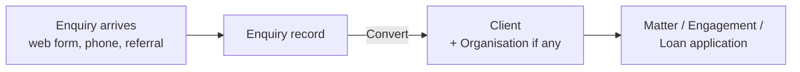
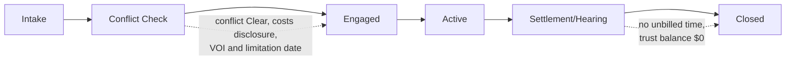
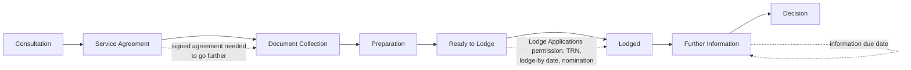
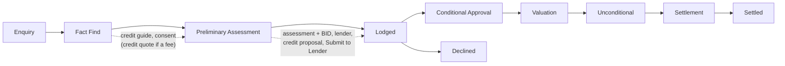

# How each profession's workspace works

Meridian CRM sets each firm up for its profession at sign-up: **Law firm**, **Migration agency**,
**Accounting practice** or **Loan broking**. This document walks through each one from first enquiry to
closed file: the records involved, the stages, the checks the system enforces (and the exact message you
see when one stops you), what happens automatically, reminders, the client portal and the reports.

Step-by-step guides for each profession: [Legal Practice](user-guide-legal.md),
[Migration Practice](user-guide-migration.md), [Accounting Practice](user-guide-accounting.md),
[Loan Broking](user-guide-lending.md). Who can do each step is set by profiles; see
[Roles and permissions](roles-and-permissions.md).

- [What every workspace shares](#what-every-workspace-shares)
- [Law firm](#law-firm)
- [Migration agency](#migration-agency)
- [Accounting practice](#accounting-practice)
- [Loan broking](#loan-broking)
- [Changing the defaults](#changing-the-defaults)

> The packs support compliance; they don't replace professional judgement. Each practice should confirm
> thresholds, due dates and retention periods against current rules for its profession and state.

---

## What every workspace shares

**Words follow the profession.** Contacts are called *Clients* (accounting: *Contact People*), accounts are
*Organisations* (accounting: *Clients*), leads are *Enquiries* (accounting: *Prospects*) and cases are
*Client Requests* (in the *Client Requests* queue). Lists, lookups, related lists, reports, role names and
e-mails use the same words. Sources and statuses use a practice's words too (*Professional Referral*,
*Client Referral*, *Follow-up*, *Not Proceeding*; organisation types *Prospective Client*, *Client*,
*Referral Partner*, *Supplier*).

**The common start: enquiry → client.**

1. Record the enquiry under **Enquiries** (or it arrives from your website form). Each profession asks its
   own question: *Area of Law*; *Visa Interest* and *Current Visa Expiry*; *Service Required* and *Entity
   Type*; *Loan Purpose* and *Approximate Loan Amount*.
2. Qualify it, then open it and choose **Convert**. The system checks for an existing client with the same
   details first, so you don't create duplicates. Converting creates the client (and organisation, when
   there is one) and makes the enquiry read-only.
3. From the client, create the profession's main record from its related list (**New**).

**Everywhere:**

- **Stages** appear as a path across the top of the record. Select the next stage and choose
  **Mark as Current Stage** (or **Mark Stage as Complete** to move one step). The system checks the
  stage's conditions first and explains anything missing.
- **Numbers** are automatic (for example `LM-2026-0001`).
- **The team** named on a record (responsible solicitor and supervising principal, responsible RMA and case
  officer, responsible accountant and reviewer, broker and loan processor) gets read/write access
  automatically, and **My …** list views include the records you're named on.
- **Actions** (buttons such as *Lodge Application*) appear only when they apply, and the server checks again
  when you run one: *"… isn't available for this record now."* if the record has moved on.
- **Final records are locked**: signed agreements and letters, billed time, ledger entries and signed-off
  reconciliations show without Edit or Delete.
- **History** records every change to important fields (who, when, from → to). The **Audit Log** in Setup
  records sign-ins, exports, permission changes, overrides, signatures and document reminders.
- **Calendar**: each profession's key dates appear in amber next to your events and tasks.
- **Activities**: tasks, events, calls and notes on any record, with reminders in the bell menu.
- **Invoices**: every profession bills from the standard Invoices tab; invoices link back to the matter,
  engagement or application. An individual client is billed in their own name. A GST tax invoice can't be
  issued without the firm's ABN (*"Add the practice's ABN in Setup → Company & Branding before issuing tax
  invoices."*).
- **Professional registration** on each user: practising certificate number, MARN (7 digits), tax agent
  number (8 digits) or credit representative number (6 or 7 digits), checked when saved.
- **Client portal**: clients see their own records only, with internal fields hidden. When something waits
  for them (a document to sign, documents still needed) they're e-mailed a link; if nobody at the client can
  sign in, the person who acted is notified instead. Signing is client-only: staff can't sign on a client's
  behalf.
- **Deleting**: deleted records go to the Recycle Bin and can be restored. Records that must be kept
  (trust and client-account ledgers, BID records) can't be deleted early.
- **Practice Settings** (Setup → Settings) holds each profession's thresholds, rates, due dates and reminder
  lead times.

---

## Law firm

**App:** Legal Practice · **Colour:** navy · **Tabs:** Home, Enquiries, Clients, Organisations, Matters,
Time Entries, Trust Ledger, Trust Reconciliations, Invoices, Calendar, Reports, Dashboards.

### Records

| Record | Purpose |
|---|---|
| **Matter** (`LM-YYYY-0000`) | The file: client and client type, billing organisation, practice area, responsible solicitor, supervising principal, court details, limitation date, billing method, rate or fixed fee, estimated costs, costs disclosure (method, date, update due), WIP, billed to date and trust balance. |
| **Party** | Everyone else involved: other party, their lawyer, witnesses, experts, insurers, guarantors. Feeds the conflict search. |
| **Conflict Check** (`CC-00000`) | Names searched, matches found, result, who checked, who cleared and why. |
| **Time Entry** (`TE-000000`) | 6-minute units, rate, amount, narrative, billable flag, status (Unbilled / Billed / Written Off). |
| **Court Date** | Hearings, mentions, filing deadlines, named from the type and date; can be shown to the client. |
| **Trust Transaction** (`TR-000000`) | Receipts, payments and transfers to office in the trust ledger, with the method and any AUSTRAC report reference. |
| **Trust Reconciliation** | The monthly reconciliation: bank statement balance, uncleared items, total of matter ledgers, difference, sign-off. |

Clients get *Date of Birth*, *Identity Verified* and *Identity Verified On* fields; organisations get
*ACN*.

### Stages

### Step by step

1. **Open the matter** from the client. New matters start at *Intake* (*"New matters start at Intake."*)
   and move to *Conflict Check* as the check runs. The responsible solicitor defaults to you; the hourly rate
   defaults to the practice rate ($380 to start).
2. **Conflict check runs automatically** when the matter is created and whenever a party is added. It
   searches other matters' parties and, for every name except your own client, your clients, organisations
   and contacts.
   - No matches → **Clear**. Matches → **Potential Conflict**: the responsible solicitor is notified, and only
     a **principal** (*Clear Conflicts*) can clear it, recording why (or the waiver). Clearing is audited.
   - **Run Search Again** on the check after adding parties.
3. **Engage.** The matter can't move to *Engaged* or later until:
   - the conflict check is **Clear**: *"Clear the conflict check before engaging on this matter."*;
   - **costs disclosure** is given (Legal Profession Uniform Law s 174): *"Give the client costs disclosure
     (Legal Profession Uniform Law s 174) before work starts, or record an estimate of $750 or less."*
     Not required when the estimate is $750 or less, the matter is pro bono, or the client is a commercial
     or government client (s 170). Up to $3,000 the **Uniform Standard Disclosure Form** may be used; above
     that, **full written disclosure** (*"The uniform standard disclosure form is only for costs up to
     $3,000…"*);
   - for the practice areas that need it (conveyancing by default), the client's **identity is verified**
     (VOI; ARNECC rules): *"Verify [client]'s identity (VOI) before acting on a Property & Conveyancing
     matter…"*;
   - for personal injury and litigation, the **limitation date** is recorded (or the court file number once
     proceedings are filed): *"Record the limitation date before engaging on a Litigation matter…"*
4. **Significant changes.** When the estimate rises by 10% or more after disclosure, *Updated Disclosure
   Due* is ticked and the solicitor notified (s 174(1)(b)). Billing waits until the new disclosure date is
   recorded, and a bill that takes the matter 10% or more past the estimate is refused.
5. **Record time** in 6-minute units (1–240). Amount = hours × rate (the entry's, else the matter's, else the
   practice default). Not on a closed matter. Unbilled billable time is the matter's **WIP**.
6. **Bill.** **Invoice Unbilled Time** (hourly matters) creates a draft invoice, one line per entry, and
   marks the entries *Billed*. **Invoice Fixed Fee** (fixed-fee matters) bills the agreed fee once and
   absorbs the time. A principal can **Write Off** an entry with a reason. **Billed to Date** follows the
   matter's issued invoices.
7. **Trust money** (needs *Manage Trust Account*):
   - **Receipt**, **Payment**, or **Transfer to Office** (only against an issued, unpaid invoice on the same
     matter, no more than its balance; it records the payment on the invoice).
   - Payments and transfers go by EFT, BPAY or cheque, **never cash or card**: *"Trust money is paid out only
     by EFT, BPAY or cheque, never in cash (Legal Profession Uniform General Rules)."*
   - A matter's balance can't go below zero: *"Trust money can't be overdrawn (available on this matter:
     …)"*; the matter is locked while posting.
   - A **cash receipt of $10,000 or more** creates a task to report it to AUSTRAC within 15 business days
     (Financial Transaction Reports Act); the **AUSTRAC Report Reference** is the one thing that can be
     added to a trust record afterwards.
   - The ledger is append-only: *"Trust records can't be changed or deleted; record a correcting
     transaction."*
   - **Trust Statement** (matter → ⌄ More actions) shows every entry with the running balance, to print or
     save as PDF.
8. **Monthly trust reconciliation** (Uniform General Rules, within 15 working days after month end): the
   Trust Accountant records the month end, bank statement balance and uncleared items; the system totals the
   matter ledgers up to the month end and works out the difference. A **principal** signs it off (*Status:
   Reconciled*) only when the difference is $0: *"The trust account doesn't reconcile (difference $…)…"* /
   *"A principal signs off the trust reconciliation."* A signed-off reconciliation is locked; each month can
   be reconciled once.
9. **Court dates**: add them on the matter; tick *Visible to Client* to show them in the portal.
10. **Close.** Not with unbilled time (*"Bill or write off the unbilled time before closing the matter."*) or
    money in trust (*"Account for the $… held in trust before closing the matter."*). Matters with time or
    trust records can't be deleted (7-year retention).

### Reminders and calendar

| What | When | Who |
|---|---|---|
| Limitation date | 90, 30 and 7 days before (until the matter is closed) | Responsible solicitor (else the matter's owner) |
| Court date | 7 days and 1 day before | The person appearing (else the court date's owner) |
| Trust reconciliation | From the 10th of the month, if last month isn't reconciled yet (once each) | Principals and Trust Accountants |

Court dates and limitation dates show on the calendar.

### Client portal

Clients see their matters (stage, key dates, the estimate and trust balance; not the rate, WIP, billed to
date, conflict status, the supervising principal or the internal description), court dates marked visible,
and their invoices, and can send Client Requests.

### Reports and dashboard

*Practice Dashboard*: open matters by stage, practice areas, work in progress, billable hours this month,
limitation dates. Reports also include trust balances by matter and solicitor workload. List views include
*Monthly Reconciliations*, *Costs Disclosure Updates Due* and *Cash Receipts (AUSTRAC)*.

---

## Migration agency

**App:** Migration Practice · **Colour:** teal · **Tabs:** Home, Enquiries, Clients, Organisations, Matters,
Visa Types, Invoices, Client Account, Calendar, Reports, Dashboards.

### Records

| Record | Purpose |
|---|---|
| **Visa Type** | Subclass, stream, category, default professional and government (VAC) fees, and the **document checklist template** (one document per line). A new workspace starts with common subclasses (fees blank). |
| **Matter** (`MAT-YYYY-0000`) | The application: client, sponsor and nomination (TRN, status, approval date), visa type, stage, status, priority, onshore/offshore, responsible RMA, case officer, ImmiAccount TRN, lodge-by deadline, lodgement date, bridging visa, information due date, decision, outcome, grant number, visa expiry, fees. |
| **Matter Applicant** | Everyone on the application: primary, secondary, dependants, sponsor, nominator. |
| **Checklist Item** | One required document: Requested → Uploaded → Received → Approved (or Not Required); can be shown to the client. |
| **Service Agreement** (`SA-00000`) | Scope, fees, estimated disbursements, Consumer Guide confirmation, the agent and their MARN, and the client's e-signature. |
| **Client Account Transaction** (`TRX-000000`) | Deposits, withdrawals and transfers to office in the client account (trust) ledger. |

Clients get citizenship, country of birth, **passport number (encrypted)**, passport expiry, current visa and
its expiry, in-Australia and Privacy Act consent fields. Organisations get approved-sponsor details and
sponsorship expiry.

### Stages

### Step by step

1. **Open the matter** from the client. New matters start at *Consultation*. Choosing the **visa type**
   copies its default fees and **creates the document checklist** (**Generate Checklist** adds items the
   visa type gained later).
2. **Team.** The **Case Officer** and **Responsible RMA** get read/write access automatically.
3. **Service agreement (Code of Conduct).** Create it on the matter, describe the scope, tick **Consumer
   Guide Provided**, then **Send to Client**.
   - *"Confirm the Consumer Guide has been provided (Code of Conduct)."* (a Practice Setting).
   - The agreement records the **agent** (the responsible RMA, else the sender) and their **MARN**: *"Add
     [agent]'s MARN in Setup → Users before sending the agreement…"*
   - Sending moves the matter to *Service Agreement* and e-mails the client a link to sign.
   - The client signs in the portal (**Sign Agreement**: typed full name, time and IP recorded and
     audited). Signed or cancelled agreements can't be changed.
4. **The agreement gate.** *"A signed service agreement is needed before moving past Service Agreement (Code
   of Conduct)."* A Practice Manager can **Override Agreement Gate** with a reason (audited).
5. **Documents.** The client uploads against visible checklist items and presses **I've Uploaded This**
   (the case officer is notified); staff mark items Received / Approved. **Send Document Reminder** e-mails
   the client what's still outstanding.
6. **Lodge.** At *Ready to Lodge*, someone with **Lodge Applications** chooses **Lodge Application** and
   enters the **ImmiAccount TRN**; the lodgement date is set. Refused when the **lodge-by** date (invitation
   or nomination) has passed, or an employer sponsored visa has no sponsor or **nomination TRN**. Without the
   permission: *"Moving a matter to Lodged or beyond needs the Lodge Applications permission."*
7. **Further information (s 56).** Moving to *Further Information* needs the **Information Due** date:
   *"Enter the date the Department's request for more information must be answered by."*
8. **Decision.** Record the **Outcome** (Granted, Refused, Withdrawn, Invalid), grant number and visa expiry
   (Lodge Applications only; only once lodged: *"Record the decision once the application has been
   lodged."*). It sets the decision date, moves the matter to *Decision*, **closes** it (Withdrawn for a
   withdrawn application) and calculates the processing time.
9. **Client account (trust).** Under **Client Account**:
   - **Deposit**, **Withdrawal** or **Transfer to Office**, always for a client (the matter, if given, must
     be theirs).
   - The balance can't go negative; transfers to office need an **issued, unpaid invoice for the same
     client** (*"The invoice is for a different client."*), can't exceed its balance, and record the payment
     on the invoice.
   - Entries can't be changed or deleted. **Client Account Statement** (client → ⌄ More actions) shows the
     running balance.
   - Matters with client-account transactions can't be deleted, and the client's personal data can't be
     erased (7-year retention).

### Reminders and calendar

| What | When | Who |
|---|---|---|
| Lodge-by deadline | 14, 7 and 2 days before (until lodged) | Case officer, else responsible RMA |
| Further information due | 7 and 2 days before, and on the day | Case officer, else responsible RMA |
| Visa expiry (on the matter) | 90 and 30 days before | Responsible RMA (else the owner) |
| Passport expiry, current visa expiry (on the client) | 90 and 30 days before | Client's owner |
| Sponsorship expiry (on the organisation) | 90 and 30 days before | Organisation's owner |

Lodge-by, information-due and visa expiry dates show on the calendar.

### Client portal

Clients see their matters (stage and dates, not fees, the team, the override, processing time or internal
notes), their document checklist (and upload against it), their service agreements with the agent's name
and MARN to read and **sign**, and invoices.

### Reports and dashboard

*Practice Dashboard*: matters by stage, grant rate, agent workload, matters by visa type, upcoming visa
expiries. Reports also include processing time by visa type and client account balances. List views
include *Further Information Due*, *Lodgement Deadlines* and *Visas Expiring (90 days)*.

---

## Accounting practice

**App:** Accounting Practice · **Colour:** violet · **Tabs:** Home, Prospects, Clients, Contact People,
Engagements, Lodgement Deadlines, Time Entries, Invoices, Calendar, Reports, Dashboards.

### Records

| Record | Purpose |
|---|---|
| **Client** (organisation record) | Entity type, **TFN (encrypted, check digit)**, ABN (check digits), GST registration, BAS frequency, financial year end, client manager, **identity verified**, **agent nominated** (client-to-agent linking). |
| **Engagement** (`JOB-YYYY-0000`) | One job: type, financial year and period, lodgement due date, **responsible accountant** (the preparer), **reviewer**, fee type and agreed fee, ATO lodgement reference, notice of assessment, stage, time cost, WIP and recoverability. |
| **Engagement Letter** (`EL-00000`) | Scope, client responsibilities and fees, the tax practitioner and their tax agent number, and the client's signature (APES 305). |
| **Document Request** | One item needed from the client: Requested → Uploaded → Accepted (or Not Applicable). |
| **Lodgement Deadline** (`DL-00000`) | A due date for a return or statement: Upcoming / Overdue / Lodged / Deferred. |
| **Time Entry** (`TS-000000`) | 6-minute units against an engagement (default charge-out $220/h). |

**Engagement types:** Individual, Company, Trust and Partnership Tax Returns, SMSF Annual Return, BAS, IAS,
FBT Return, SMSF Audit, Bookkeeping, Payroll, Advisory.

### Stages

### Step by step

1. **Set up the client**: entity type, TFN and ABN (*"That TFN isn't valid. Check the digits."*), GST, BAS
   frequency, client manager (who gets access to the client). Tick **Identity Verified** once proof of
   identity is sighted, and, for a business, **Agent Nominated** once it has nominated the practice in ATO
   Online services. **Generate BAS Deadlines** creates the year's activity statement deadlines:
   - standard dates: quarterly 28 Oct, 28 Feb, 28 Apr, 28 Jul; monthly the 21st of the following month
     (December: 21 January); annual GST return 31 October;
   - with the **registered agent lodgment program** setting: quarterly 25 Nov, 28 Feb, 26 May, 25 Aug, and a
     December monthly BAS on 21 February.
2. **Create the engagement.** New engagements start at *Not Started* and automatically get the
   **financial year** (the last completed year for returns; the FBT year to 31 March for FBT), a default
   **due date** (Individual 31 Oct, Company 28 Feb, Trust and Partnership 31 Mar, SMSF 28 Feb, FBT 21 May;
   set your lodgment program dates in Practice Settings), a **document request** list for the type and a
   **lodgement deadline** that follows the engagement's due date and preparer.
3. **SMSF audit independence.** An SMSF Audit's accountant or reviewer can't be someone who prepared the
   fund's return or bookkeeping for the same year: *"The SMSF auditor must be independent of the fund…"*
4. **Engagement letter (APES 305).** **Send to Client** records the **tax practitioner** and **tax agent
   number** (theirs, else the practice's: *"Add the tax agent number…"*) and e-mails the client. The client
   signs in the portal (**Sign Engagement Letter**); a Partner can **Record Paper Signature** instead.
   Signing moves the engagement to *Awaiting Information*. Work can't start before that: *"The client must
   sign the engagement letter (APES 305) before work starts."*
5. **Collect documents.** The client presses **I've Uploaded This** on each request in the portal; staff
   accept them; **Send Document Reminder** e-mails the client what's outstanding. When every request is
   accepted, the engagement moves to *In Progress* by itself.
6. **Prepare** and record time (6-minute units). Time cost, unbilled WIP and **recoverability** (agreed fee ÷
   time cost) are kept on the engagement.
7. **Review.** Before *Ready to Lodge*, a **reviewer who isn't the preparer** must be assigned, and only the
   reviewer (or a partner) can sign off: *"Only the reviewer (or a partner) can sign off the review."*
8. **Lodge.** Needs **Lodge Returns** (*"Lodging needs the Lodge Returns permission (registered tax
   agent)."*), the client's identity verified and, for a business, the practice nominated as its agent. It
   sets the lodged date and closes the matching lodgement deadlines. Record the notice of assessment when it
   arrives.
9. **Bill.** **Invoice Engagement** bills the agreed **fixed fee once** or each unbilled time entry for
   time-based work. Then **Complete** the engagement.

### Deadlines, reminders and calendar

Deadlines turn **Overdue** automatically when the date passes. Reminders go out **14 days, 3 days and on
the day** to the deadline's *Responsible* person (else its owner), until the deadline is lodged. Open
deadlines show on the calendar.

### Client portal

Clients see their engagements (not the reviewer, time cost, WIP, recoverability or scope notes), sign
engagement letters (which show the practitioner and tax agent number), mark document requests as uploaded,
and see their invoices.

### Reports and dashboard

Engagements by stage and type, workload by preparer, WIP, recoverability, upcoming and overdue lodgements.

---

## Loan broking

**App:** Loan Broking · **Colour:** amber · **Tabs:** Home, Enquiries, Clients, Loan Applications,
Lenders, Commissions, Organisations, Calendar, Reports, Dashboards.

### Records

| Record | Purpose |
|---|---|
| **Loan Application** (`LA-YYYY-0000`) | Borrowers, purpose, loan amount, security, **LVR** and LMI flag, lender, product, rate and term, **assessment rate** and repayment, broker and loan processor, credit guide, consent, broker fee, credit quote and credit proposal dates, the BID record, approval expiry, settlement, rate review, discharge. |
| **Fact Find** (`FF-00000`) | Income, living expenses, commitments, assets and liabilities, verification; calculates net position and monthly surplus. Draft → Complete. |
| **Lender** | Your panel: BDMs, upfront and trail commission rates, clawback period and halving point. |
| **Commission** (`COM-000000`) | Upfront, Trail or Clawback (negative) amounts, Expected → Received. |

Clients get date of birth, residency, first-home-buyer, ID-check fields and an **encrypted driver's licence
number**.

### Stages

### Step by step (NCCP and Best Interests Duty)

1. **Create the application** at *Enquiry* or *Fact Find*. LVR, the LMI flag (above 80%), the assessment
   rate (the product rate plus the 3% buffer, or the floor) and the repayment at that rate are calculated.
2. **Before credit assistance**: the **credit guide** date, the client's **privacy and credit-check consent**
   and, if the client pays a fee, the **credit quote** (s 114). Without them nothing moves past Fact Find.
3. **Fact find**: income, living expenses, commitments, assets and liabilities, then **verify** income and
   expenses and mark it **Complete**.
4. **Preliminary assessment and BID.** Complete the requirements and objectives, products considered and
   why the recommendation is in the client's best interests, then **Record Preliminary Assessment**. It needs
   a completed, verified fact find, the rate and term, and the repayment at the assessment rate within the
   client's monthly surplus (*"The loan looks unsuitable: …"*). Recording **locks the BID record** and is
   audited. A change to the amount, purpose, borrower or a switch of lender before lodging clears it, so the
   assessment is made again.
5. **Lodge with a lender**: needs a current assessment (made within 90 days, or 120 days for buying
   residential property, s 115; an expired one is recorded again), a lender, the **credit proposal
   disclosure** (s 121) and **Submit to Lender**.
6. **Approval to settlement**: Conditional Approval → Valuation → Unconditional → Settlement.
7. **Settled**: sets the settlement date, schedules a **rate review a year later**, and creates the
   **expected upfront commission** from the lender's upfront rate. A settled or declined application's stage
   can't change (a Principal Broker can correct it).
8. **Discharge**: **Record Discharge** on a settled loan creates an **expected clawback** within the lender's
   clawback period: all the upfront commission, or half after the lender's halving point.
9. **Declined or withdrawn**: record why (*"Record why the application was declined or withdrawn."*).
10. **Commissions** (needs **Manage Commissions**): amounts can't be edited (*"Commission amounts can't be
    changed; record a clawback or a new entry."*); clawbacks are negative entries; brokers can read the
    commission on their own loans.

Applications with a recorded assessment can't be deleted for **7 years**.

### Reminders and calendar

All go to the application's *Broker* (else its owner), and stop once the work is finished.

| What | When | Stops when |
|---|---|---|
| Settlement date | 7 days and 1 day before | Settled or declined |
| Approval expiry | 14 days before | Settled or declined |
| Fixed-rate expiry | 90 and 30 days before | Declined, or the loan discharged |
| Rate review | 7 days before | Declined, or the loan discharged |

Settlements, approval expiries and fixed rate expiries show on the calendar (not for declined applications
or discharged loans).

### Client portal

Clients see their loan applications and progress (with the lender's name; not the broker or processor,
products considered, commissions, the lender reference or decline notes), and their invoices.

### Reports and dashboard

Pipeline by stage, settled volume by lender, broker volume, commission by type and by lender, upcoming
settlements and fixed-rate expiries.

---

## Changing the defaults

| To change | Where |
|---|---|
| Stage names, picklist values, fields, page layouts | Setup → Object Manager → (record type) |
| The rate for one matter or engagement | The record's *Hourly Rate* / fee fields |
| Practice defaults: hourly or charge-out rate, costs disclosure thresholds, significant change and cash thresholds, VOI and limitation practice areas, Consumer Guide requirement, tax agent number, BAS due dates, return due dates, serviceability buffer and floor, retention years, reminder lead times | Setup → Settings → **Practice Settings** (needs *Customize Application* to change) |
| Firm name, ABN, address, logo | Setup → Settings → Company & Branding |
| Professional registration numbers | Setup → Users → (user) |
| Who can lodge, clear conflicts, manage trust or commissions | Setup → Profiles → (profile) → profession permissions |
| Role names and hierarchy | Setup → Roles |
| Which apps and tabs people see | Setup → App Manager |
| Visa types and checklist templates | Visa Types tab (migration) |
| Add another practice area to the same workspace | Setup → Industry Packs → Install (navigation and terminology stay as they are) |

The compliance gates (conflict clearance, costs disclosure, VOI and limitation dates, the trust rules,
service agreement, lodge-by and nomination checks, engagement letter, review, identity and agent linking,
credit guide, quote and proposal, the preliminary assessment and BID) are enforced on the server and can't
be switched off from a page layout; the override paths are the audited permissions listed above.

**Updates.** New versions of a profession's pack add their fields, list views, picklist values and tabs to
existing workspaces automatically when the server starts, without overwriting anything an administrator
changed. No SQL needs to be run.
