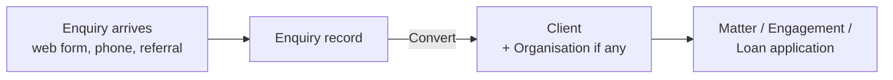
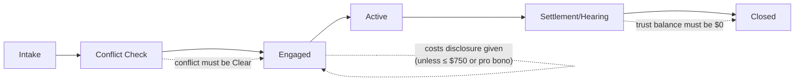
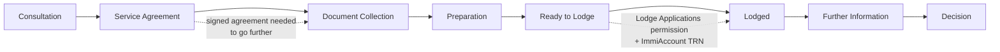
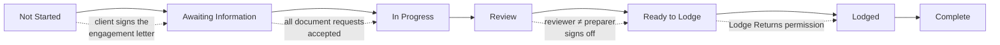
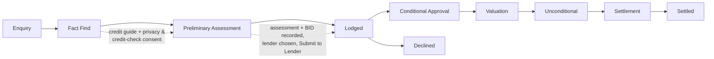

# How each profession's workspace works

Meridian CRM sets each firm up for its profession at sign-up: **Law firm**, **Migration agency**,
**Accounting practice** or **Loan broking**. This document walks through each one from first enquiry to
closed file: the records involved, the stages, the checks the system enforces (and the exact message you
see when one stops you), what happens automatically, reminders, the client portal and the reports.

Who can do each step is set by profiles; see [Roles and permissions](roles-and-permissions.md).

- [What every workspace shares](#what-every-workspace-shares)
- [Law firm](#law-firm)
- [Migration agency](#migration-agency)
- [Accounting practice](#accounting-practice)
- [Loan broking](#loan-broking)
- [Changing the defaults](#changing-the-defaults)

> The packs support compliance; they don't replace professional judgement. Each practice should confirm
> thresholds, due dates and retention periods against current rules for its profession and state.

---

## What every workspace shares

**Words follow the profession.** Contacts are called *Clients* (accounting: *Contact People*), accounts are
*Organisations* (accounting: *Clients*), and leads are *Enquiries* (accounting: *Prospects*). Lists,
lookups, related lists and reports use the same words.

**The common start: enquiry → client.**

1. Record the enquiry under **Enquiries** (or it arrives from your website form).
2. Qualify it, then open it and choose **Convert**. The system checks for an existing client with the same
   details first, so you don't create duplicates. Converting creates the client (and organisation, when
   there is one) and makes the enquiry read-only.
3. From the client, create the profession's main record from its related list (**New**).

**Everywhere:**

- **Stages** appear as a path across the top of the record. Select the next stage and choose
  **Mark as Current Stage** (or **Mark Stage as Complete** to move one step). The system checks the
  stage's conditions first and explains anything missing.
- **Numbers** are automatic (for example `LM-2026-0001`).
- **History** records every change to important fields (who, when, from → to). The **Audit Log** in Setup
  records sign-ins, exports, permission changes, overrides and signatures.
- **Activities**: tasks, events, calls and notes on any record, with reminders in the bell menu.
- **Invoices**: every profession bills from the standard Invoices tab; invoices link back to the matter,
  engagement or application.
- **Client portal**: clients see their own records only, with internal fields hidden.
- **Deleting**: deleted records go to the Recycle Bin and can be restored. Records that must be kept
  (trust and client-account ledgers, BID records) can't be deleted early.

---

## Law firm

**App:** Legal Practice · **Colour:** navy · **Tabs:** Home, Enquiries, Clients, Organisations, Matters,
Time Entries, Trust Ledger, Invoices, Calendar, Reports, Dashboards.

### Records

| Record | Purpose |
|---|---|
| **Matter** (`LM-YYYY-0000`) | The file: client, billing organisation, practice area, responsible solicitor, supervising principal, court details, limitation date, billing method and rate, costs disclosure, WIP and trust balance. |
| **Party** | Everyone else involved: other party, their lawyer, witnesses, experts, insurers, guarantors. Feeds the conflict search. |
| **Conflict Check** (`CC-00000`) | Names searched, matches found, result, who checked, who cleared and why. |
| **Time Entry** (`TE-000000`) | 6-minute units, rate, amount, narrative, billable flag, status (Unbilled / Billed / Written Off). |
| **Court Date** | Hearings, mentions, filing deadlines; can be shown to the client. |
| **Trust Transaction** (`TR-000000`) | Receipts, payments and transfers to office in the trust ledger. |

Clients get *Date of Birth* and *Identity Verified (on)* fields; organisations get *ACN*.

### Stages

### Step by step

1. **Open the matter** from the client (**New** in the Matters list). New matters always start at
   *Intake*.
2. **Conflict check runs automatically** when the matter is created and again whenever a party is added.
   It searches other matters' parties and, for every name except your own client, your clients,
   organisations and contacts.
   - No matches → the check is **Clear**.
   - Matches → **Potential Conflict**. The responsible solicitor is notified. Only a **principal** (the
     *Clear Conflicts* permission) can clear it, and must record why the matches aren't a conflict (or
     the waiver). Clearing is audited.
   - Added parties later? Use **Run Search Again** on the check.
3. **Engage.** The matter can't move to *Engaged* or later until:
   - the conflict check is **Clear**: *"Clear the conflict check before engaging on this matter."*; and
   - **costs disclosure** has been given (Legal Profession Uniform Law s 174), unless the estimated legal
     costs are $750 or less or the matter is pro bono: *"Give the client costs disclosure (Legal Profession
     Uniform Law s 174) before work…"* Tick *Costs Disclosure Provided* and enter the date.
4. **Record time** under Time Entries: units of 6 minutes (1-240). Hours = units × 0.1; amount = hours ×
   rate (the matter's hourly rate, otherwise the practice default, $380 to start). Time can't be recorded
   on a closed matter. Unbilled billable time rolls up as **WIP** on the matter.
5. **Bill.** On the matter, **Invoice Unbilled Time** creates a draft invoice with one line per unbilled
   entry and marks those entries *Billed*. Billed or written-off time is locked. A principal can
   **Write Off** an entry, with a reason.
6. **Trust money** (needs *Manage Trust Account*):
   - **Receipt**: money received into trust for the matter.
   - **Payment**: paid out of trust. The ledger can't go below zero for a matter (*"Trust money can't be
     overdrawn (available on this matter: …)"*); the matter is locked while posting so two payments can't
     race.
   - **Transfer to Office**: only against an **issued, unpaid invoice on the same matter**, and not more
     than its balance; the transfer records the payment on the invoice.
   - The ledger is append-only: *"Trust records can't be changed or deleted; record a correcting
     transaction."*
   - The **Trust Ledger** list (filter by matter) shows every entry with the balance after it. A formal
     per-matter trust statement is available through the API (`/api/v1/packs/legal_practice/trust-statement/{matter}`)
     for the trust accountant or external examiner; there's no on-screen statement yet.
7. **Court dates**: add them on the matter; tick *Visible to Client* to show them in the portal.
8. **Close.** The matter can't close with money in trust: *"Account for the $… held in trust before
   closing the matter."* Matters with time or trust records can't be deleted (7-year retention).

### Reminders

| What | When | Who |
|---|---|---|
| Limitation date | 90, 30 and 7 days before | Responsible solicitor (else the matter's owner) |
| Court date | 7 days and 1 day before | The person appearing (else the court date's owner) |

### Client portal

Clients see their matters (stage, key dates; not rates, WIP, the supervising principal or internal
description) and court dates marked visible, plus their invoices.

### Reports and dashboard

*Practice Dashboard*: open matters by stage, practice areas, work in progress, billable hours this month,
limitation dates. Reports also include trust balances by matter and solicitor workload.

---

## Migration agency

**App:** Migration Practice · **Colour:** teal · **Tabs:** Home, Enquiries, Clients, Organisations, Matters,
Visa Types, Invoices, Client Account, Calendar, Reports.

### Records

| Record | Purpose |
|---|---|
| **Visa Type** | Subclass, stream, category, default professional and government (VAC) fees, and the **document checklist template** (one document per line). Set these up first. |
| **Matter** (`MAT-YYYY-0000`) | The application: client, sponsor, visa type, stage, status, priority, onshore/offshore, responsible RMA, case officer, ImmiAccount TRN, lodgement and decision dates, outcome, grant number, visa expiry, fees. |
| **Matter Applicant** | Everyone on the application: primary, secondary, dependants, sponsor, nominator. |
| **Checklist Item** | One required document: Requested → Received → Approved (or Not Required); can be shown to the client. |
| **Service Agreement** (`SA-00000`) | Scope, fees, estimated disbursements, Consumer Guide confirmation, and the client's e-signature. |
| **Client Account Transaction** (`TRX-000000`) | Deposits, withdrawals and transfers to office in the client account (trust) ledger. |

Clients get citizenship, country of birth, **passport number (encrypted)**, passport expiry, current visa and
its expiry, in-Australia and Privacy Act consent fields. Organisations get approved-sponsor details and
sponsorship expiry.

### Stages

### Step by step

1. **Open the matter** from the client. New matters start at *Consultation*. Choosing the **visa type**:
   - copies its default professional and government fees onto the matter; and
   - **creates the document checklist** from the visa type's template (use **Generate Checklist** to
     re-create it later).
2. **Team.** Setting the **Case Officer** and **Responsible RMA** gives them read/write access to the
   matter automatically (and removes it when they change).
3. **Service agreement (Code of Conduct).** In *Service Agreements* on the matter, create one (fees come
   from the matter), describe the scope, tick **Consumer Guide Provided**, then **Send to Client**.
   - Sending without the Consumer Guide confirmation is refused: *"Confirm the Consumer Guide has been
     provided (Code of Conduct)."*
   - Sending moves the matter from Consultation to *Service Agreement*.
   - The client opens it in the portal and chooses **Sign Agreement**: they type their full name and
     accept. The name, time and IP address are recorded and audited. Signed or cancelled agreements can't
     be changed.
4. **The agreement gate.** A matter can't move past *Service Agreement* without a signed agreement:
   *"A signed service agreement is needed before moving past Service Agreement (Code of Conduct)."* In a
   genuine exception, someone with **Override Agreement Gate** can use that action on the matter, with a
   reason; it's recorded in the audit log.
5. **Documents.** Work through the checklist: the client sees the items marked visible in the portal and
   uploads against them; staff mark items Received / Approved.
6. **Lodge.** At *Ready to Lodge*, a registered agent (the **Lodge Applications** permission) chooses
   **Lodge Application** and enters the **ImmiAccount TRN**. The matter moves to *Lodged* and the lodgement
   date is set. Without the permission: *"Moving a matter to Lodged or beyond needs the Lodge Applications
   permission."*
7. **Further information.** Move to *Further Information* while responding to requests from the
   Department.
8. **Decision.** Record the **Outcome** (Granted, Refused, Withdrawn, Invalid), grant number and visa
   expiry. Recording an outcome sets the decision date (if empty), moves the matter to *Decision* and
   calculates the processing time in days. Only the Lodge Applications permission can record a decision.
9. **Client account (trust).** Under **Client Account**:
   - **Deposit**, **Withdrawal** or **Transfer to Office**, always for a client (and optionally one of
     their matters: *"The matter belongs to a different client."* otherwise).
   - The balance can't go negative; transfers to office need an **issued, unpaid invoice** and can't exceed
     its balance, and they record the payment on the invoice.
   - Entries can't be changed or deleted; correct with a new entry.
   - Matters with client-account transactions can't be deleted (7-year retention).

### Reminders

| What | When | Who |
|---|---|---|
| Visa expiry (on the matter) | 90 and 30 days before | Responsible RMA (else the owner) |
| Passport expiry, current visa expiry (on the client) | 90 and 30 days before | Client's owner |
| Sponsorship expiry (on the organisation) | 90 and 30 days before | Organisation's owner |

### Client portal

Clients see their matters (stage and dates, not fees, the team or internal notes), their document checklist
(and upload against it) and their service agreements to read and **sign**, plus invoices.

### Reports and dashboard

*Practice Dashboard*: matters by stage, grant rate, agent workload, matters by visa type, upcoming visa
expiries. Reports also include processing time by visa type and client account balances.

---

## Accounting practice

**App:** Accounting Practice · **Colour:** violet · **Tabs:** Home, Prospects, Clients, Contact People,
Engagements, Lodgement Deadlines, Time Entries, Invoices, Calendar, Reports.

### Records

| Record | Purpose |
|---|---|
| **Client** (organisation record) | Entity type, **TFN (encrypted)**, GST registration, BAS frequency, client manager. |
| **Engagement** (`JOB-YYYY-0000`) | One job: type, financial year and period, lodgement due date, **responsible accountant** (the preparer), **reviewer**, fee type and agreed fee, ATO lodgement reference, stage, time cost, WIP and recoverability. |
| **Engagement Letter** | Scope and fees, sent to the client to sign (APES 305). |
| **Document Request** | One item needed from the client: Requested → Uploaded → Accepted (or Not Applicable). |
| **Lodgement Deadline** | A due date for a return or statement: Upcoming / Overdue / Lodged / Deferred. |
| **Time Entry** | 6-minute units against an engagement (default charge-out $220/h). |

**Engagement types:** Individual, Company, Trust and Partnership Tax Returns, SMSF Annual Return, BAS, IAS,
FBT Return, SMSF Audit, Bookkeeping, Payroll, Advisory.

### Stages

### Step by step

1. **Set up the client** (organisation record): entity type, TFN, GST, BAS frequency, client manager.
   For BAS clients, choose **Generate BAS Deadlines** on the client to create the year's activity
   statement deadlines: quarterly 28 Oct, 28 Feb, 28 Apr and 28 Jul; monthly the 21st of the following
   month; or annual.
2. **Create the engagement.** New engagements start at *Not Started* and automatically get:
   - the right **financial year** and a default **due date** for the type (Individual 31 Oct, Company 28
     Feb, Trust and Partnership 31 Mar, SMSF 28 Feb, FBT 21 May, all editable in settings; confirm against
     your lodgment program);
   - a **document checklist** (document requests) for the engagement type; and
   - a **lodgement deadline**.
3. **Engagement letter (APES 305).** Create the letter, **Send to Client**; the client signs in the portal
   (**Sign Engagement Letter**, typed full name). Signing moves the engagement to *Awaiting Information*.
   Work can't start before that: *"The client must sign the engagement letter (APES 305) before work
   starts."* Signed letters can't be changed.
4. **Collect documents.** The client marks each request **I've Uploaded This** in the portal; staff accept
   each one. When every request is accepted the engagement moves to *In Progress* by itself.
5. **Prepare** and record time (6-minute units). Time cost, unbilled WIP and **recoverability** (agreed fee ÷
   time cost) are kept on the engagement.
6. **Review.** Before *Ready to Lodge*, a **reviewer who isn't the preparer** must be assigned (*"Assign a
   reviewer before the work is ready to lodge."*, *"The reviewer must be someone other than the
   preparer."*), and only the reviewer, or a registered tax agent with **Lodge Returns**, can sign it off.
7. **Lodge.** Moving to *Lodged* needs **Lodge Returns** (*"Lodging needs the Lodge Returns permission
   (registered tax agent)."*). It sets the lodged date and closes the matching lodgement deadlines.
8. **Bill.** **Invoice Engagement** bills the agreed **fixed fee once** (*"This fixed-fee engagement has
   already been invoiced."* if repeated), or each unbilled time entry for time-based work.
9. **Complete** the engagement.

### Deadlines and reminders

Deadlines turn **Overdue** automatically when the date passes. Reminders go out **14 days, 3 days and on
the day** to the deadline's *Responsible* person (else its owner).

### Client portal

Clients see their engagements, sign engagement letters and mark document requests as uploaded, and see
their invoices.

### Reports and dashboard

Engagements by stage and type, workload by preparer, WIP, recoverability, upcoming and overdue lodgements.

---

## Loan broking

**App:** Loan Broking · **Colour:** amber · **Tabs:** Home, Enquiries, Clients, Loan Applications,
Lenders, Commissions, Organisations, Calendar, Reports, Dashboards.

### Records

| Record | Purpose |
|---|---|
| **Loan Application** (`LA-YYYY-0000`) | Primary and co-borrower, purpose, loan amount, security property and value, **LVR**, lender, product, rate type and interest rate, fixed-rate expiry, term, broker and loan processor, credit guide and consent dates, the BID record, approval expiry, settlement date, next rate review. |
| **Fact Find** | Income, living expenses, assets and liabilities; calculates net position and monthly surplus. Draft → Complete. |
| **Lender** | Your panel: contacts, BDMs, upfront and trail commission rates. |
| **Commission** | Upfront, Trail or Clawback (negative) amounts, Expected → Received. |

Clients get residency, first-home-buyer, ID-check fields and an **encrypted driver's licence number**.

### Stages

### Step by step (NCCP and Best Interests Duty)

1. **Create the application** at *Enquiry* or *Fact Find* (*"New applications start at Enquiry or Fact
   Find."*).
2. **Before credit assistance**: record the date the **credit guide** was given and the client's **privacy
   and credit-check consent**. Without them nothing moves past Fact Find (*"Give the client your credit
   guide before providing credit assistance."*, *"Record the client's privacy and credit-check consent."*).
3. **Fact find**: enter income, living expenses, assets and liabilities (*"Enter income and living expenses
   before completing the fact find."*), then mark it **Complete**. Net position and monthly surplus are
   calculated.
4. **Preliminary assessment and BID.** Complete the BID record: the client's **requirements and
   objectives**, the **products considered** and **why the recommendation is in the client's best
   interests**. Then **Record Preliminary Assessment**. It needs the completed fact find (*"Complete a
   fact find (income, expenses, assets and liabilities) first."*) and the BID fields (*"Complete the
   requirements, products considered and recommendation reasons first."*). Recording **locks the BID
   record** and is audited.
5. **Lodge with a lender**: needs the assessment, a lender and the **Submit to Lender** permission
   (*"Record the preliminary assessment and Best Interests Duty before lodging."*, *"Lodging with a lender
   needs the Submit to Lender permission."*).
6. **Approval to settlement**: Conditional Approval → Valuation → Unconditional → Settlement. LVR updates
   from the loan amount and security value.
7. **Settled**: sets the settlement date, schedules a **rate review a year later**, and creates the
   **expected upfront commission** from the lender's upfront rate.
8. **Declined or withdrawn**: record why (*"Record why the application was declined or withdrawn."*).
9. **Commissions** (needs **Manage Commissions**): record trail and received amounts. Amounts can't be
   edited: *"Commission amounts can't be changed; record a clawback or a new entry."* Clawbacks are
   negative entries.

Applications with a recorded assessment can't be deleted for **7 years**.

### Reminders

All go to the application's *Broker* (else its owner).

| What | When |
|---|---|
| Settlement date | 7 days and 1 day before |
| Approval expiry | 14 days before |
| Fixed-rate expiry | 90 and 30 days before |
| Rate review | 7 days before |

### Client portal

Clients see their loan applications and progress, and their invoices.

### Reports and dashboard

Pipeline by stage, settled volume by lender, broker volume, commission by type and by lender, upcoming
settlements and fixed-rate expiries.

---

## Changing the defaults

| To change | Where |
|---|---|
| Stage names, picklist values, fields, page layouts | Setup → Object Manager → (record type) |
| The rate for one matter or engagement | The record's *Hourly Rate* / fee fields |
| Practice defaults: default hourly or charge-out rate, costs-disclosure threshold, reminder days, return due dates, retention years | Stored as workspace settings by the pack. There's **no screen for these yet**; an administrator with database access can change them (`org_settings`, keys `legal_practice`, `migration_agency`, `accounting_practice`, `loan_broker`). |
| Who can lodge, clear conflicts, manage trust or commissions | Setup → Profiles → (profile) → profession permissions |
| Which apps and tabs people see | Setup → App Manager |
| Visa types and checklist templates | Visa Types tab (migration) |
| Add another practice area to the same workspace | Setup → Industry Packs → Install (navigation and terminology stay as they are) |

The compliance gates (conflict clearance, costs disclosure, service agreement, engagement letter, review,
lodgement, BID) are enforced on the server and can't be switched off from a page layout; the override paths
are the audited permissions listed above.
